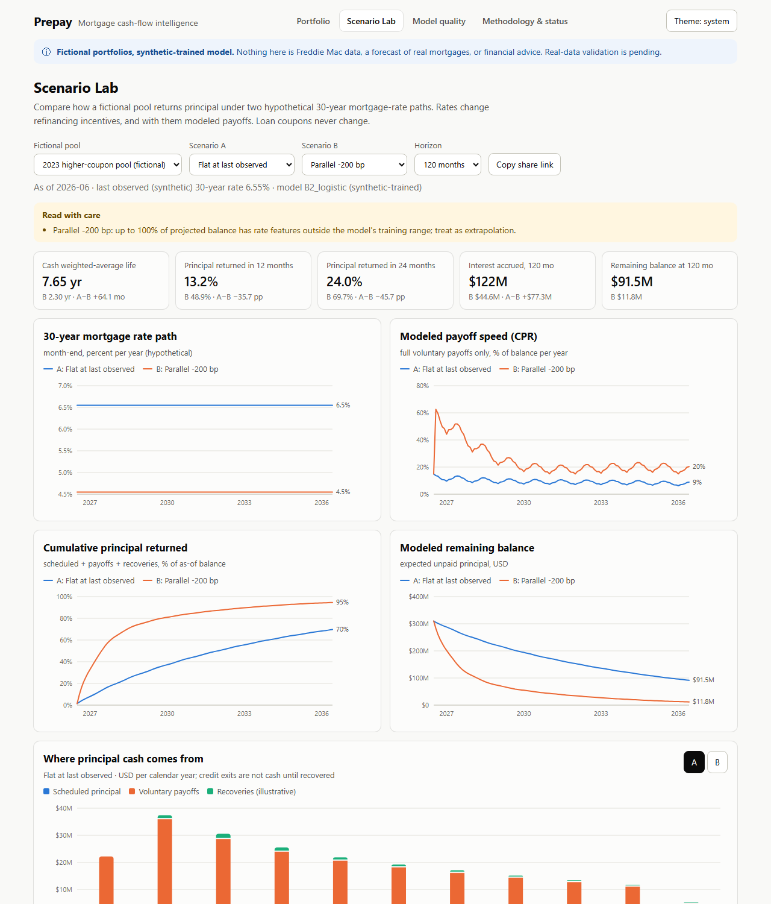
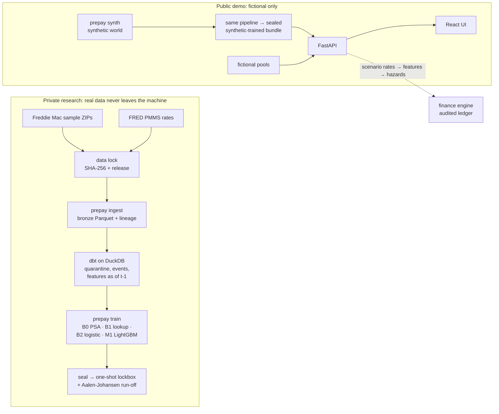

# Prepay: mortgage cash-flow intelligence

**When will a mortgage pool return its principal if rates move?** Prepay models, month by month,
whether each fixed-rate loan pays off early, exits through a credit disposition, or stays
active. It then turns those probabilities into an audited cash-flow ledger for hypothetical
pools under interest-rate scenarios.

[](https://github.com/s2002kumar/PrePay/actions/workflows/ci.yml)

> **Status (2026-10-29):** the full system is built and tested on **synthetic data** (M0–M5).
> **Real-data study run privately, unpublished:** the Freddie Mac Release 48 sample was
> ingested, audited, trained on and evaluated once on a sealed holdout (ADR 0006). Its results,
> including failed checks, stay private until the dataset terms have been reviewed.
> **No hosted demo yet:** hosting needs the owner's approval. The demo runs locally or in
> Docker. Nothing here claims real-world predictive accuracy. See [docs/STATUS.md](docs/STATUS.md).



*Fictional pool, synthetic-trained model (`dev` preset). Not a forecast of real mortgages.*

## Why it matters

A 30-year mortgage rarely lasts 30 years: borrowers move and refinance. For whoever holds the
loan, *when* principal comes back changes reinvestment risk, interest income and duration. If
payoff speed is underestimated after a rate drop, cash arrives years early and must be
reinvested at lower rates. If it's overestimated, capital stays locked in low-coupon loans.
Prepay makes that timing explicit, with every assumption labeled.

## What works today

| Capability | Status | Evidence |
|---|---|---|
| Source contract for Freddie Mac SFLLD Release 47/48 | implemented, header-verified against official files | [ADR 0002](docs/decisions/0002-sflld-source-contract.md) |
| Data lock, streaming ingest, byte-exact lineage | implemented on synthetic data | `tests/integration/test_ingest.py` |
| dbt silver/gold: quarantine, event labels, point-in-time features | implemented on synthetic data | [ADR 0003](docs/decisions/0003-event-labels-and-hazard-panel.md) |
| PSA, lookup, logistic and LightGBM competing-risk models | trained on synthetic data | [ADR 0004](docs/decisions/0004-model-protocol.md) |
| Sealed, one-shot holdout + censor-aware cohort backtest | implemented on synthetic data | [VALIDATION_REPORT](docs/VALIDATION_REPORT.md) |
| Audited cash-flow engine (Decimal oracle, mutation tests) | implemented | [FINANCE_ENGINE](docs/validation/FINANCE_ENGINE.md) |
| FastAPI + responsive web demo (fictional pools only) | implemented, runs locally and in Docker | [ADR 0005](docs/decisions/0005-public-demo-boundary.md) |
| Real-data training and validation | **run privately, unpublished** pending terms review; not independently reviewed | [Runbook](docs/RESEARCH_RUNBOOK.md), [Status](docs/STATUS.md) |
| Hosted public demo | **blocked**: needs hosting approval | [Deployment](docs/DEPLOYMENT.md) |

## How it works



- **Labels** (MODELING §2): payoff = zero-balance code 01 not near maturity. Credit disposition
  = 02/03/09. Modification, whole-loan sale (15), RPL securitization (16) and defect (96)
  **censor**; they are never mislabeled as defaults. Data problems are quarantined and counted,
  never repaired.
- **No look-ahead:** every feature for month *t* uses information known at the end of *t−1*. A
  dbt test enforces it, a corrupted-warehouse test proves the test fails, and an independent
  Python state machine reproduces every feature exactly.
- **Honest evaluation:** models are tuned on 2018, calibrated on 2019, sealed, and opened once on
  2020+. The first report is immutable even when a baseline wins. In the small synthetic world
  it did: the parsimony rule kept the lookup table, which then lost to the logistic model. With
  8× the data the same rule picked the logistic model, which beat the other baselines on every
  holdout window. Both reports stand as written
  ([§5](docs/VALIDATION_REPORT.md#5-synthetic-study-results-engineering-demonstration)).
- **Money is conserved:** scheduled principal + payoffs + credit exits + remaining balance equals
  the starting balance every month. This is checked against a 60-digit Decimal oracle and by 8
  deliberate mutants that the tests must kill.

## Run it

Requirements: Python 3.12 via [uv](https://docs.astral.sh/uv/), Node 24, and GNU make (Linux,
macOS or WSL2). On Windows without make, run the `uv run ...` commands from the `Makefile`
directly.

```bash
make setup                 # uv sync --frozen
make check                 # ruff, mypy --strict, sqlfluff, all Python tests (synthetic, offline)
make demo-bundle           # fictional pipeline end to end -> build/demo (~3 min)
                           # DEMO_PRESET=dev: 8x larger world, as in the screenshots
(cd web && npm ci --ignore-scripts && npm run build)
make demo                  # http://127.0.0.1:8000
```

Or `docker build -t prepay-demo . && docker run --rm -p 8000:8000 prepay-demo`.

Other useful targets: `make synthetic-study` (full research pipeline through the lockbox on
fictional data), `make benchmark` (wall time / peak RSS per stage), `make publication-check`,
`make test-finance`. Real data: see the [private research runbook](docs/RESEARCH_RUNBOOK.md).

## Repository map

| Path | Contents |
|---|---|
| `src/prepay/finance/` | pure cash-flow engine, rates/PSA, WAL, Monte Carlo, rep lines |
| `src/prepay/contracts/`, `ingest/` | verified source layout, data lock, streaming bronze ingest |
| `transform/` | dbt project (staging → intermediate → marts) with data tests |
| `src/prepay/features/` | feature contract, scenario state machine, panel reader |
| `src/prepay/modeling/`, `evaluation/` | models, metrics, selection, seal/lockbox, cohort backtest |
| `src/prepay/scenarios/`, `api/` | rate scenarios, fictional pools, projection, FastAPI service |
| `src/prepay/synthetic/` | seeded synthetic SFLLD-format world with known ground truth |
| `web/` | React UI, Playwright E2E + axe accessibility tests |
| `docs/` | specification, ADRs, status, validation, benchmarks, review packets |

## Evidence and engineering standards

CI runs on every PR: lint, strict typing, 270+ Python tests, a finance coverage gate (≥90%), web
lint/typecheck/tests, Playwright E2E with axe (WCAG 2.1 AA) on every view in light and dark, and
a publication gate over history and build outputs. CodeQL, Dependabot and secret scanning are on,
and `main` requires all checks. Measured baseline: [BENCHMARKS](docs/BENCHMARKS.md). Reviewer
packets: [M2](docs/reviews/M2.md), [M4](docs/reviews/M4.md), [M5](docs/reviews/M5.md). All
reviews so far are self-review by the implementing agent; **no independent review has
happened.**

## Limitations

Synthetic results show that the software works, not that it predicts real mortgages. It is not
an MBS waterfall, a valuation or OAS tool, or lending/investment advice. It doesn't model
curtailments, delinquency cash timing or servicing. Credit severity and recovery lag are
illustrative inputs. See the [validation report](docs/VALIDATION_REPORT.md) §8.

## Data and license

Real data: [Freddie Mac Single-Family Loan-Level Dataset](https://www.freddiemac.com/research/datasets/sf-loanlevel-dataset)
(registration required, [terms](https://capitalmarkets.freddiemac.com/crt/docs/pdfs/fre_terms_conditions_sflld.pdf)).
No loan files, derived rows or real-trained models are in this repository or the demo. Rates:
FRED [MORTGAGE30US](https://fred.stlouisfed.org/series/MORTGAGE30US) /
[MORTGAGE15US](https://fred.stlouisfed.org/series/MORTGAGE15US).

**Code license: none selected yet.** The repository is public for review, but no open-source
license has been granted. That is the owner's decision.
