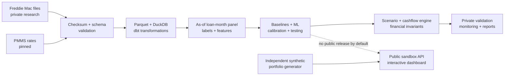

# Prepay | Mortgage Cash-Flow Intelligence

**Status: specification reviewed; implementation not started. Public source repository intended; restricted data stays local.** All performance claims remain unproven until the real-data validation run. This repository is a reproducible, end-to-end research and demonstration application, **not an investable security valuation or financial advice system**.

## The question

A mortgage scheduled to last 30 years often ends earlier when its borrower sells or refinances. How soon principal returns changes the value of *time* for a mortgage investor or treasury analyst. Prepay estimates monthly payoff behavior using historical US mortgages and shows the resulting cash-flow timing for clearly labeled **hypothetical** mortgage pools and interest-rate scenarios.

## What a finished Prepay does

1. Validates and transforms locally acquired, release-pinned Freddie Mac Standard **sample** origination and monthly-performance files plus public mortgage-rate series.
2. Trains probabilistic models for three mutually exclusive next-month outcomes: **voluntary early payoff**, **terminal credit-related disposition**, or **remain active**. Modification, 90-day delinquency, maturity and loan sales are handled separately—not mislabeled as the same event.
3. Backtests probabilities on later, untouched calendar periods against transparent baselines. Evaluates cash-flow timing separately, with explicit hindsight-rate and deployable-rate assumptions.
4. Uses a tested amortization and pool-cash-flow engine to project **contractual principal/interest under assumptions**, prepayment proceeds, credit-exit principal, illustrative recoveries, WAL, and remaining principal under alternative mortgage-rate paths.
5. Provides a polished, responsive web demo for **entirely fictional portfolios**. Real Freddie-derived loan rows, representative lines, model weights, and outputs are never served or published by default. Approved aggregate research findings may be published after a license review.
6. Documents what the model predicts reliably, what it does not, and how to reproduce results from files the researcher obtained lawfully.

## Scope and intellectual honesty

Prepay is a strong **data engineering + statistical ML + applied financial modeling** project. It is **not** a real MBS cash-flow waterfall, an OAS/security-pricing product, a precise prediction of collected interest on delinquent loans, or a mortgage lender credit decision system. It intentionally does not claim to outperform a commercial model or guarantee superiority over baselines.

## Pipeline

## Roadmap

- [ ] **M0**: project skeleton, reproducible tooling/CI, synthetic fixtures, data-license gate
- [ ] **M1**: pinned ingestion, manifests, official schema adapter, rates and data-quality checks
- [ ] **M2**: as-of panel, audited event taxonomy, exposure and historical cohort summaries
- [ ] **M3**: baselines, ML models, calibration, honest validation and run registry
- [ ] **M4**: audited cash-flow engine, scenarios, historical cohort studies, stress tests
- [ ] **M5**: separate public synthetic demo, API, security/deployment, documentation, honest model report

See [product specification](docs/SPEC.md), [architecture](docs/ARCHITECTURE.md), [modeling/validation](docs/MODELING.md), [financial conventions](docs/FINANCIAL_CONVENTIONS.md), [execution runbook](docs/EXECUTION.md), [engineering review standard](docs/ENGINEERING_STANDARD.md), and [source/legal research](docs/SOURCE_RESEARCH.md).

## Data and license

Original historical data: [Freddie Mac Single-Family Loan-Level Dataset](https://www.freddiemac.com/research/datasets/sf-loanlevel-dataset); registration required. Loan files are NOT shipped. The July 2026/Release 47 source guide and its file-layout rules must be reconciled with the exact release downloaded. Rates: [FRED MORTGAGE30US](https://fred.stlouisfed.org/series/MORTGAGE30US) and [MORTGAGE15US](https://fred.stlouisfed.org/series/MORTGAGE15US). Review Freddie Mac's [terms](https://capitalmarkets.freddiemac.com/crt/docs/pdfs/fre_terms_conditions_sflld.pdf) before publishing *any* derived result, artifact, or public model.

**Running project:** `make setup`, `make check`, `make demo`, `make research` once implementation exists. The exact command behaviors are specified in the architecture. Do not claim any command works until it has actually been implemented and tested.
