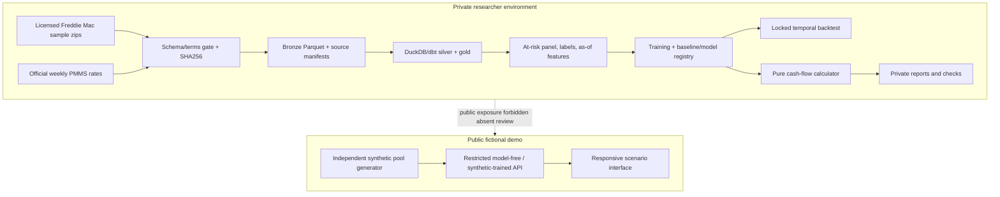

# Prepay | Engineering architecture

Version 2.0 • 2026-10-27

## 1. Bounded, high-integrity design

This is an intentionally **single-machine** research pipeline and **separately isolated** web demo. It demonstrates production-quality choices without adding Kafka, Spark or a paid cloud warehouse without a measured need.



## 2. Explicit data contracts

| Layer | Location | Grain | Invariant |
|---|---|---|---|
| Raw | `data/raw/` | exact received ZIP bytes + PMMS snapshots | private, immutable, SHA-256 and source timestamp |
| Bronze | `data/bronze/{release}/{vintage}/` | origination record or observed month | source schema/version, source file/row lineage, exact field preservation |
| Silver | `data/silver/` | one origination per ID, one observed loan/month | typed, decoded, sentinel masks, no contradictory keys |
| Gold | `data/gold/` | eligible loan-month / cohort-month | feature `max_available_period <= t-1`, valid label and exposure |
| Model | `artifacts/runs/{run_id}/` | immutable experimental run | data/source/feature/config/git hashes, fitted preprocessing, metrics |
| Public | `web/public/fixtures/` | fictional aggregate line | generated independently without reading restricted data |

`configs/data.lock.json` records actual downloaded files, release, cutoff, SHA256, byte count, schema variant, terms accepted reference; no raw rows. It may be committed if it contains no sensitive account or licensed content. Atomic pipeline outputs use write-to-temp + fsync/rename and manifests; every task compares input fingerprints and either safely reuses or rebuilds downstream outputs.

The dataset's 50k loans per vintage can result in **many tens or hundreds of millions of monthly records**. Plan for bounded memory: Parquet column projection and partition pruning, DuckDB streaming ingestion/SQL, Arrow batches, and model training samples or external-memory-compatible routines where documented. Capture runtime, rows/s, peak RSS, disk use; benchmark full pipeline and do not promise it fits untested memory.

## 3. Real-source compatibility adapter

- Pin the July 2026 **Release 47** layout if that is what the researcher downloads. Obtain the official *actual file-layout artifact*; a broken web preview is not permission to infer columns from a prior version. Validate ZIP content, expected column counts, field type/format, unique loan IDs, correct vintage, permitted zero-balance codes and coding changes.
- Files `sample_YYYY.zip` contain `sample_orig_YYYY.txt` and `sample_perf_YYYY.txt` according to the July 2026 user guide. Source files are pipe-delimited and headerless; do not infer schema from data. Maintain contract fixtures for release version changes.
- Backfill corrections are tracked as a **new release**, not overwritten in place. Handle latest month/cutoff by actual downloaded manifest, not by system date.
- Schema failure stops a run visibly; errors and disqualifying loan counts go to a dedicated report. Do not silently drop rows or assume missing = zero.
- Date joining: month granularity canonical `YYYY-MM` with explicit time boundaries; weekly FRED average uses observations released/known by end of prior calendar month, not an unannotated future rate.
- Unknown credit/DTI/LTV sentinels are column-specific; null in gold plus missingness flags, with row-count reconciliation after transform.

## 4. dbt lineage

`transform/models/staging/` = typed `stg_originations`, `stg_performance`, `stg_pmms`;
`transform/models/intermediate/` = `int_loan_month_state`, `int_exit_events`, `int_at_risk`, `int_monthly_rates`;
`transform/models/marts/` = `fct_hazard_panel`, `fct_monthly_exposures`, `fct_cohort_events`, `dim_portfolio_characteristics`.

Use source freshness and schema tests, unique/nonnull IDs+periods, accepted values, valid transitions, one first terminal/censor state, monotone calendar period, no rows after exit, event-outcome sum, as-of provenance and reconciled counts between each stage. SQL business transformations documented with source column, logic, reason and effective date. Unsupported gap histories are censored/flagged rather than invented.

## 5. Inference and simulation parity

Two separated packages:

- `src/prepay/features/`: **one deterministic feature state machine** for historical and projected monthly PMMS paths (lags, seasoning, historical refinancing opportunity/burnout). Given snapshot at t0, it advances without accessing future realized borrower observations. Golden parity tests reproduce features from silver/gold on the actual historical PMMS path.
- `src/prepay/finance/`: **pure** finance engine (no model calls, no I/O, deterministic float64), takes initial balance/terms, coherent `P(prepay)`, `P(terminal_credit_exit)` per future month and month-indexed assumptions, then returns a reconciled cash-flow ledger. Model predictions are computed before passing to finance, and effects of censor events are not confused with repayment.

Public API **must not** load `data/`, `artifacts/runs` trained on real data, or live database connections. Its deployment image uses synthetic fixture outputs or a synthetic-trained demonstrator that is explicitly labeled; require review before any alternative source is allowed.

## 6. Scenario interfaces

A rate path is a monthly pair `(mortgage15, mortgage30)` at minimum. Rate scenario specifications: last-observed flat baseline; parallel fixed shocks -200/-100/+100/+200 bps; optional custom user path bounded to economically sensible positive levels. `t0` and PMMS snapshot are shown. The loan's contractual note rate **does not change** when market rates change. Only hypothetical future refinance incentives and hence early exits change. Scenario probabilities may be unreliable beyond training covariate support; UI annotates out-of-support conditions rather than claiming precision.

Historical evaluation uses two labeled modes: **historical-rate hindsight diagnostic** (rates realized later, isolates behavioral model error) and **as-of scenario** (only rates available as of t0; forecast cannot be compared as though it knew later market rates). Compare with actual outcomes for both, with those different interpretations explicit.

## 7. Run registry and sealed holdouts

The pipeline writes a versioned `run-manifest.json` with data-lock digest, feature contract hash, train/validation periods, model hyperparameters, calibration, software lock digest and Git SHA. A `seal` command writes an immutable candidate digest plus evaluation config, predeclared thresholds and accepted exclusions. A first-and-only holdout evaluation for that digest writes **append-only** metrics, tables and hashes. Any later experiments are `v2` with a new ID and must not replace v1 first-report results.

Actual holdout file access is unavoidable for ingestion and transformations but **logical test outcomes and summary charts must remain gated**: no training/threshold setting/selection on test periods; gate guards evaluation entrypoints and output paths. Keep development logs from accidentally showing holdout performance.

## 8. Deployable API (synthetic only)

- `GET /health` returns version and artifact class (`synthetic`).
- `GET /pools` returns several human-friendly **fictional** choices with provenance and aggregate pool parameters.
- `POST /project` validates `pool_id`, `scenario`, `horizon_months` and optional user-defined shocks, returns month-by-month scheduled principal, principal prepaid, illustrative loss/recovery, contractual interest, end balance, cumulative return, WAL and assumptions; rejects implausible values with typed 422.
- `GET /methodology` returns feature definitions, rate-source info and model/dataset permissions.

Bounded request payloads, strict Pydantic schemas, max horizon ≤360, precomputed default pools, caching by validated scenario request, response latency sampled, rate limits and security headers. No unrestricted filesystem or arbitrary SQL access. Demo state should be link-shareable without storing user history.

UX deliverable: sophisticated but restrained finance interface, readable rate path vs prepayment path charts, synchronized table and hover, scenario compare, a visible assumptions drawer and error/empty/loading states, strong mobile design and accessibility keyboard labels.

## 9. Source tree

```
prepay/
  README.md
  CLAUDE.md             # local operator instructions; may be excluded from git
  pyproject.toml  uv.lock  Makefile  .github/workflows/
  configs/{prepay.toml,sources.toml,data.lock.json}
  src/prepay/{cli,contracts,ingest,rates,quality,features,modeling,finance,evaluation,publication,api}/
  transform/{dbt_project.yml,models,macros,tests}/
  tests/{fixtures,unit,integration,financial,modeling,security}/
  web/{src,public/fixtures}/
  docs/{SPEC,ARCHITECTURE,MODELING,FINANCIAL_CONVENTIONS,EXECUTION,SOURCE_RESEARCH,VALIDATION_REPORT}.md
  data/ artifacts/ reports/ scratch/      # strictly local, gitignored
```

## 10. Commands (required when implemented)

`make setup` setup, `make check` complete offline synthetic CI, `make demo` serve synthetic, `make data-lock` verify lawful private source files, `make research` local-only ingest/transform/train/validate, `make seal` seal candidate, `make evaluate-lockbox` guarded one-shot holdout, `make test-finance` full finance suite, `make publication-check` scan public assets and manifests, `make benchmark` measure resource use. All targets implement helpful `--help`/documented errors, fail non-zero on violations and produce metrics/logs.

## 11. Repo hygiene

Conventional Commits, small topical PRs, CI before merge, a short ADR for meaningful financial/model changes, changelogs for source contracts and migrations, thorough code review checklists. No forced AI mentions or fabricated authorship claims. Never suppress useful engineering review for prettier commits. Each versioned model artifact carries proof of source data permissions and can be loaded only in an allowed runtime.
