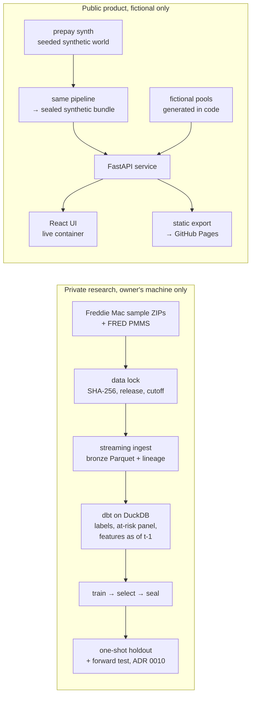

# How Prepay works

This is the as-built explanation. `ARCHITECTURE.md` is the original design blueprint, and the
ADRs under `docs/decisions/` record why things are the way they are.

## The question and the answer's shape

*How much principal does a fixed-rate mortgage pool return each month under a hypothetical
mortgage-rate path, and when?*

Each month, every loan has three possible outcomes:
- it pays off in full early;
- it leaves through a credit disposition;
- it stays active.

A model gives the three probabilities per loan and month. A finance engine turns them into
expected cash flows:
- scheduled principal;
- payoffs;
- credit exits and lagged recoveries;
- contractual interest;
- the remaining balance.

The answer is a monthly ledger plus a few summary numbers: the share of today's balance
returned within 12 and 24 months, cash weighted-average life (WAL), and the remaining balance
at the horizon. Every number carries a unit and a formula (Methodology page; `/api/methodology`).

## Two worlds that never touch

The same code runs in both worlds. Only the inputs differ:
- **Public side:** the code runs on a synthetic world whose true hazards are known. The bundle
  loader refuses any run not marked synthetic, or whose seal fails to verify (ADR 0005).
- **Private side:** the code runs on Freddie Mac's sample, on the owner's machine. Nothing from
  that side is committed, published or served. A publication gate scans tracked files, git
  history and every build output (`prepay publication-check`).

## Life of a projection

What happens when someone compares "flat" with "−100 bp" for the 2023 pool. File links are to
`src/prepay/`.

1. **Validate the request.** Strict Pydantic contracts (`api/schemas.py`): horizon ≤ 360 months,
   shocks within ±500 bp, rates 0.5–20%, a 32 KiB body cap and a per-client rate limit
   (`api/app.py`).
2. **Build the rate path.** `scenarios/rates.py` extends the synthetic PMMS history from the
   as-of month, flat or shifted, or along a custom path. Month 1 uses the rate known at the
   as-of month, so a scenario acts from month 2.
3. **Compute point-in-time features.** For every loan and future month, `features/machine.py`
   computes the same features the model was trained on, using only information available at
   the end of the previous month:
   - incentive: note rate minus market rate;
   - burnout;
   - loan age;
   - the 6-month rate change;
   - seasonality;
   - static loan attributes.

   It is one state machine for history and for scenarios. A parity test checks it against the
   dbt features on the historical path.
4. **Predict hazards.** The bundle's sealed model returns P(payoff), P(credit exit) and
   P(active), checked to sum to 1 (`modeling/models.py`). Unless the credit hazard passed the
   sufficiency rule, credit exits use a stated constant CDR instead (`reliability/credit.py`).
   The response says which.
5. **Run the ledger.** The pure engine (`finance/ledger.py`) does the arithmetic. It has no I/O
   and no model calls. For each loan and month:
   - scheduled principal comes first;
   - then same-month payoffs and credit exits;
   - recoveries arrive after a lag.

   It checks money conservation on every projection.
6. **Summarize and qualify.**
   - `finance/metrics.py` computes WAL, CPR and the horizon totals.
   - `reliability/support.py` checks how much of the projected balance sits outside the
     model's training range. The result is a verdict: supported, extrapolating or unsupported.
   - The service also projects the other fitted model families, and reports the spread as
     model disagreement, not as a confidence interval.
7. **Respond.** Both scenarios, their A−B differences, the assumptions in force, and any
   warnings. Results are cached by the validated request; the standard scenarios are
   precomputed at startup.

## Where correctness comes from

Each critical claim is checked by a second, independent implementation:

| Claim | Independent check |
|---|---|
| Event labels (payoff, credit exit, censoring) | dbt SQL vs a plain-Python decision table; 14 golden cases written from the spec (`tests/integration/test_spec_golden_cases.py`) |
| No look-ahead in features | a dbt test, plus a corrupted-warehouse test proving the test fails; the scenario state machine reproduces the dbt features |
| Money conservation and amortization | a 60-digit `Decimal` oracle and an exact `Fraction` oracle (`tests/financial/`); 8 deliberate mutants that the tests must kill |
| The product serves the engine's numbers | API rows equal the engine ledger exactly; every summary is recomputed from the served rows (`tests/integration/test_api_finance_parity.py`) |
| The static site equals the API | the build reassembles every response and compares; a browser test compares the static and live pages (`web/e2e/static.spec.ts`) |
| Model evaluation is honest | selection rule fixed in advance; seal, then one holdout opening; the first report is immutable even when a baseline wins (`docs/VALIDATION_REPORT.md`) |

## Public surfaces

| | Static site (GitHub Pages) | Live container |
|---|---|---|
| What | Precomputed API responses on a fixed grid | FastAPI service and the same UI |
| Scenarios | flat and ±50 to ±300 bp (13), every pair, 6 horizons | any flat, parallel or custom path |
| Credit assumptions | defaults only | adjustable |
| Build | `make demo-bundle` then `make static-site`; `pages.yml` on `main` | `docker build .` or `make demo` |
| Verified by | exact reassembly and the static-vs-live browser test | API, finance-parity and e2e tests; the CI image health check |

## Quality system

- **Every PR:**
  - ruff, mypy `--strict` and SQLFluff;
  - over 400 Python tests: unit, Hypothesis properties, oracle and mutation tests, the dbt
    pipeline on synthetic data;
  - a finance coverage gate of at least 90%;
  - web lint, type checks and Vitest;
  - Playwright end-to-end tests and axe (WCAG 2.1 AA) in light and dark, on the live app and
    the static site;
  - CodeQL;
  - the publication gate.
- **CI hygiene:** CI is synthetic and offline once dependencies install. Actions are pinned by
  SHA. The default token is read-only; only the Pages deploy job can write.
- **The container:** base images pinned by digest, a non-root user, a health check. CI builds it
  and scans its filesystem.

## Deliberately out of scope

- MBS waterfalls, valuation, OAS or discounting.
- Curtailments (partial prepayments; feasibility study in `docs/validation/CURTAILMENTS.md`).
- Delinquency cash timing and servicing.
- Adjustable-rate loans.
- Real-time scoring.
- Serving any model trained on real data.

The real-data research and the forward test run privately and are reported separately
(`docs/STATUS.md`, `docs/reviews/R2_QUALITY_GATES.md`). The public product makes no claim about
real-world accuracy.
