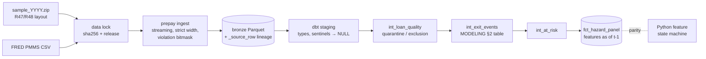

# M2 reviewer packet: data contract, ingest and feature store

Prepared 2026-10-28 by the implementing agent. **This is self-review, not independent
review.** Everything below is public-safe: synthetic data only, no Freddie Mac records.

## What exists

| PR | Scope |
|---|---|
| [#1](https://github.com/s2002kumar/PrePay/pull/1) | Blueprint import |
| [#2](https://github.com/s2002kumar/PrePay/pull/2) | Finance engine + independent Decimal oracle, tooling, CI |
| [#3](https://github.com/s2002kumar/PrePay/pull/3) | SFLLD R47/R48 source contract (header-verified) |
| [#4](https://github.com/s2002kumar/PrePay/pull/4) | Synthetic generator with ground truth and injected anomalies |
| [#5](https://github.com/s2002kumar/PrePay/pull/5) | Data lock + streaming bronze ingest + PMMS |
| [#6](https://github.com/s2002kumar/PrePay/pull/6) | dbt silver/gold, event labels, point-in-time panel |
| #7 | Python feature state machine + historical parity + benchmark (this packet) |

## How to check the main claims (10-minute path)

1. **A label is point-in-time safe.** Start at `transform/models/intermediate/int_exit_events.sql`
   (decision table) → `int_at_risk.sql` (prior-month condition) → `marts/fct_hazard_panel.sql`
   (every rate joined at `t-1`, `t-2`, `t-7`). The guard is
   `transform/tests/assert_features_use_only_prior_month_rates.sql`; that it has teeth is shown by
   `tests/integration/test_transform.py::test_guards_fail_on_corrupted_gold`.
2. **The labels are right.** `tests/integration/label_oracle.py` reimplements quarantine and the
   decision table in plain Python from bronze. `test_sql_labels_match_independent_python_oracle`
   requires exact equality on every panel row.
3. **The features are right.** `test_gold_features_reproduce_true_hazards` recomputes the
   generator's true hazard from gold features (max error < 1e-9). `test_feature_parity.py` shows
   the scenario state machine reproduces every gold feature on the historical path.
4. **Trace one record.** Every bronze row has `_source_file` and `_source_row`.
   `test_bronze_preserves_every_field_with_exact_lineage` rejoins each row and matches the source
   line byte for byte.
5. **The finance oracle** (M0, ahead of schedule): `tests/financial/oracle.py`, plus 8/8
   mutation kills in `test_mutation_kills.py`.

## Commands and results

| Command | Result (Windows dev laptop, 2026-10-28) |
|---|---|
| `uv run pytest` | 202 passed |
| `uv run ruff check src tests` / `ruff format --check` | clean |
| `uv run mypy` (strict; also `--platform linux`) | clean, 38 files |
| `uv run sqlfluff lint transform/models transform/tests` | clean |
| `uv run prepay benchmark --preset dev` | see [BENCHMARKS.md](../BENCHMARKS.md) |
| CI (`make check` + finance coverage gate on ubuntu-24.04) | green on every merged PR |

## Five highest-risk assumptions

1. **Real Release 48 files match the documents.** Strict width and domains will fail loudly on
   a trailing delimiter or `C`/`U` net-sales markers, but nobody has run on real files yet.
2. **Event month = reporting period of the terminal record.** Effective-date mismatches are
   counted, not quarantined (ADR 0003 §3). Real counts may force a change.
3. **Unexplained record ends are labeled A in their last month.** That's correct if the loan
   really was active. If real data often ends without a code, it hides an unknown exit.
4. **Synthetic validation shares conventions with the generator.** Oracle and truth checks show
   the code matches the written definitions. They can't show the definitions fit Freddie's
   reporting.
5. **dbt memory at full scale.** 2 GiB peak at 3.1M rows. The full sample is ~30× larger and
   unmeasured. DuckDB should spill, but that's unproven here.

## Known limitations

- No real data processed (blocked on owner registration). The pre-R47 fallback adapter is
  blocked (no official layout artifact).
- Ingest isn't profiled or optimized (85.7k rows/s).
- dbt rebuild byte-determinism isn't tested; ingest's is.
- No independent human review.

## Candidate interview questions

1. *Why is code 15 a censoring event and not a default?* The guide defines 15 as a whole-loan
   sale. The loan leaves the dataset for a business reason, and its later outcome is unobserved.
2. *How do you prove no look-ahead?* Every rate join is at `t-1` or earlier. A dbt test checks the
   observation date. A corrupted-warehouse test shows the check fails, and features recomputed
   independently reproduce the known true hazard.
3. *Why quarantine instead of fixing anomalies?* Repairs need assumptions the documents don't
   support. Quarantine is counted and attributed, so its effect on the population is visible.
4. *How does burnout stay point-in-time without a loan × month spine?* A cumulative in-the-money
   index per (note rate, series), differenced at `t-1` and `first payment - 1`.
5. *What would you check first on real data?* Field-count and domain violation counts, the
   zero-balance date mismatch rate, unexplained ends, and the share of first-month events.
