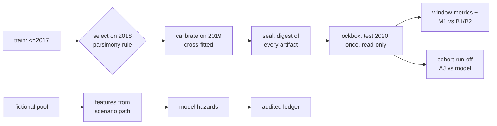

# M4 reviewer packet: finance engine, scenarios, sealed evaluation

Prepared 2026-10-28 by the implementing agent. **Self-review, not independent review.**
Synthetic data only.

## What changed since M2

| PR | Scope |
|---|---|
| [#8](https://github.com/s2002kumar/PrePay/pull/8) | B0/B1/B2/M1, validation-only selection, cross-fitted calibration, seal + one-shot lockbox |
| [#9](https://github.com/s2002kumar/PrePay/pull/9) | Rate scenarios, fictional pools, model-driven full-life projection, finance disclosures |
| #10 | Censor-aware cohort backtest (Aalen–Johansen) inside the lockbox, validation report, this packet |

## How to check the main claims

1. **No test leakage in training:** `tests/integration/test_modeling.py::test_training_never_reads_test_months`
   spies on the reader, and `windows.read_window` refuses test windows without a verified seal.
2. **The first holdout report is immutable:** `test_seal_and_one_shot_lockbox` shows a second
   evaluation is refused; `test_tampering_after_seal_is_detected` edits one model file after
   sealing.
3. **Rate shocks don't touch contract coupons:**
   `tests/unit/test_scenarios.py::test_6_7_rate_shock_with_fixed_hazards_leaves_contractual_flows_identical`.
4. **The cohort estimator is right:** `tests/unit/test_cohort.py` has hand-computed censored
   examples and a property that the incidences plus survival sum to 1.
5. **Honest results:** [VALIDATION_REPORT.md](../VALIDATION_REPORT.md) §5, where the selected model
   loses to B2 and the report says so.

## Commands

| Command | Result |
|---|---|
| `uv run pytest` | 235 passed (Windows dev laptop) |
| `make test-finance` | finance coverage ≥ 90% gate (95%) |
| `uv run prepay finance-report` | regenerates `docs/validation/FINANCE_ENGINE.md` |
| `make synthetic-study` | full pipeline through the lockbox on fictional data |

## Five highest-risk assumptions

1. **Parsimony selection on small validation sets** picks underpowered baselines. Observed
   synthetically. Real data volumes should narrow the intervals, but that's unproven.
2. **Informative censoring:** Aalen–Johansen assumes censoring is independent of payoff risk.
   Modifications aren't, so realized incidence is biased in an unknown direction.
3. **Count-weighted cohort incidence** is the backtest estimand. Balance-weighted cash
   run-off against observed balances isn't validated (curtailments are unobserved).
4. **Tree extrapolation:** M1 responds flatly or non-monotonically far outside training incentives.
   Out-of-support flags are reported, but users may still read the precision literally.
5. **Illustrative credit economics:** severity and lag are inputs, not estimates. Credit-exit
   hazards rest on few events.

## Known limitations

No real data; no PSI drift, seed repeats, ablations or segment reports; rep lines are
an approximation benchmark only; recovery timing is fixed per scenario.

## Candidate interview questions

1. *Why compute both hindsight-rate and as-of-rate backtests?* Hindsight isolates the behavioral
   model. As-of measures what a forecaster could actually have known. Mixing them hides where
   error comes from.
2. *Why is Aalen–Johansen needed instead of counting payoffs?* Censored loans leave the risk set
   without an outcome. Dividing by the original cohort understates incidence.
3. *The selected model lost on the holdout. What now?* Report it unchanged. Any new model is
   a new run with a new seal; the first report stays.
4. *Why project full life even for a 24-month view?* Cash WAL needs every principal flow,
   including lagged recoveries. Truncation would report a different, shorter number.
5. *How do you show that a rate shock changes only behavior?* Hold hazards fixed and shock rates;
   the ledger must be identical. Then let the model respond and compare deltas.
