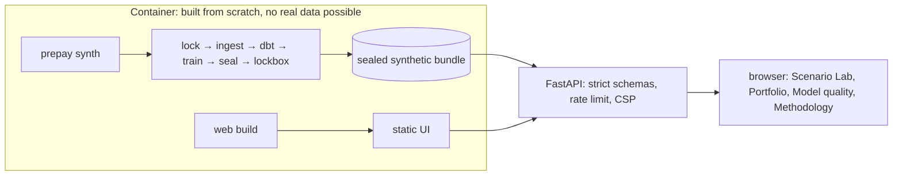

# M5 reviewer packet: product, publication boundary, release readiness

Prepared 2026-10-28 by the implementing agent. **Self-review, not independent review.**
Synthetic data only.

## What changed since M4

| PR | Scope |
|---|---|
| [#11](https://github.com/s2002kumar/PrePay/pull/11) | Synthetic-only demo bundle and strict FastAPI service (ADR 0005) |
| [#12](https://github.com/s2002kumar/PrePay/pull/12) | React UI, Playwright + axe E2E, publication gate, `web` and `e2e` CI jobs |
| #13 | Dockerfile, README, deployment guide, security policy, summary, this packet |

## How to check the main claims

1. **The demo can't serve real data:** `src/prepay/api/bundle.py::load_bundle` refuses unmarked
   bundles, failed seals and digest mismatches (`tests/integration/test_api.py::test_bundle_guards`).
   `.dockerignore` is an allowlist.
2. **Nothing restricted gets published:** `prepay publication-check` runs on the tracked set in
   `make check`, and on history, the web build and the demo bundle in CI `e2e`.
3. **The UI is usable and accessible:** `web/e2e/app.spec.ts`, with zero serious axe violations
   on every route in both themes and no horizontal scroll at 375 px.
4. **The API is strict:** ten invalid-request cases return typed 422s, plus 413, 429 and 404.
   Security headers are on every response. SPA fallback never builds a path from user input
   (a CodeQL finding, fixed in #11).

## Commands and results

| Command | Result |
|---|---|
| `uv run pytest` | all passing locally (count in `docs/STATUS.md`) |
| `cd web && npx playwright test --project desktop` | 17 passed (local Windows and CI Ubuntu) |
| `make publication-check` | `ok: true` |
| `docker build -t prepay-demo .` | see "Release verification" below |
| Clean-clone `make check` in WSL2 Ubuntu | see "Release verification" below |

## Five highest-risk assumptions

1. **Served model quality:** the demo serves whatever the pre-registered rule selects for the
   bundle's synthetic preset. The UI states it and shows out-of-support warnings, but a reader may
   still over-trust the numbers.
2. **The in-process rate limiter** is per instance and can be bypassed by distributing requests
   across instances. That's acceptable for a single small demo container only.
3. **CSP allows `'unsafe-inline'` styles** (React style attributes). Scripts remain `'self'` only.
4. **The publication gate is pattern-based.** It catches the known shapes of SFLLD rows and
   credentials, not every possible leak. Allowlisted paths still need human review.
5. **Synthetic realism:** the demo's rate history and pools are fictional by design. The scenario
   shapes look plausible but mean nothing about real markets.

## Known limitations

No hosted deployment (owner approval needed). No real-data validation. No independent review.
No code license chosen.

## Candidate interview questions

1. *How do you stop a real-data model reaching the public demo?* Synthetic markers on the bundle
   and the run, seal verification, a digest check, an allowlisted build context, and a
   publication gate on outputs. Several independent locks, each tested.
2. *Why serve the UI from the API's origin?* No CORS configuration, a strict CSP, one deployable
   unit and one health check.
3. *How are charts made accessible?* Every chart has a text alternative, a keyboard-readable
   crosshair with a live region, a legend (identity never by color alone) and a table view.
   Palettes were validated for colorblind separation.
4. *What did CodeQL catch?* Path construction from the request in the SPA fallback. It was safe in
   practice, but the route now never touches user paths, which is simpler and provably safe.
5. *What would you change for real traffic?* A shared rate limiter, horizontal scaling behind a
   proxy, request tracing, and precomputing the full scenario grid at build time.

## Release verification

Run on 2026-10-28 on Windows 11 with Docker Desktop. These are single runs on one laptop.

| Check | Result |
|---|---|
| `docker build -t prepay-demo:local .` (`ci` preset) | exit 0; image 913 MB |
| `/api/health` | `ok`, `artifact_class: synthetic`, `data_class: fictional`, model `B1_lookup` |
| Runtime user (`docker exec … id`) | `uid=10001(prepay)` |
| Docker `HEALTHCHECK` | `healthy` |
| `GET /scenario-lab` | 200, `text/html` |
| `POST /api/project` (2021 pool, flat vs −200 bp, 120 months) | 200 in 12–18 ms |
| Invalid request (`pool_id: "../etc"`) | 422 |
| Security headers | CSP, `nosniff` and `no-referrer` present |
| Publication gate over the exported app tree (`/srv/prepay`, 16 files, 1.3 MB) | `ok: true`, no findings |
| `docker build --build-arg DEMO_PRESET=dev` | exit 0 in 55 min (laptop busy with other work; upper bound); serves `B2_logistic`, `healthy` |
| `dev` container after warm-up | 887 MiB resident; uncached projection 2.4 s, cached 27–48 ms (loaded laptop) |

**Found and fixed during verification.** The first container failed at startup, because the
non-root user couldn't read the bundle. `tempfile.mkstemp` creates files with mode 0600, and
`atomic_path` kept that mode when it published outputs. Published files now get ordinary
umask-based permissions, and a POSIX test checks 0644 (`tests/unit/test_io.py`).

**Known gaps.**
- The image is large (913 MB): the runtime environment includes dependencies the API doesn't
  need.
- B2 projections are slow when uncached.

**Clean clone, after merging #13.** In WSL2 Ubuntu, a fresh `git clone` of `main` at `f8ac9e2`
with uv 0.12.1:
- `make setup` succeeded;
- `make check` exited 0 (ruff, mypy --strict, sqlfluff; **275 passed** in 448 s);
- `make test-finance` exited 0 (85 passed; finance coverage **95.60%**, gate 90%).
