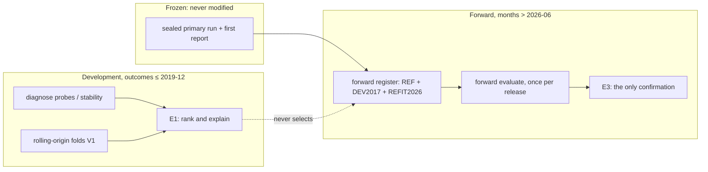

# R1 reviewer packet: financial ML reliability program (implementation and methodology)

Prepared 2026-10-29 by the implementing agent. **Self-review, not independent review.** Every
result in this packet is on synthetic data or public PMMS rates. The agent read no real-data
output (ADR 0009 §3).

**Readiness verdict: not ready for real-world claims.** The revised system has better-founded
candidates, diagnostics and safeguards. None of them has been shown to work on real loans:
- the development runs (E1) are owner-run and haven't happened;
- the forward test (E3) needs a release with a cutoff of 2027-06 or later;
- no independent review has taken place.

§8 lists what has to happen first.

## 1. Why this program exists

The frozen real-data study (ADR 0006) sealed and opened its holdout once. The selected model
(M1+T, LightGBM with temperature scaling):
- **overpredicted payoffs** in the 2022–2026 higher-rate environment;
- **underpredicted** the 2020–2021 refinance wave;
- had a poorly calibrated credit-disposition hazard.

The figures are in the private packet. The original study is unchanged.

## 2. What changed

| PR | Scope |
|---|---|
| [#17](https://github.com/s2002kumar/PrePay/pull/17) | Plan with ranked hypotheses; ADR 0009 (protocol, evidence classes, private execution); ADR 0010 (forward pre-registration and tolerances); public rate-regime facts |
| [#18](https://github.com/s2002kumar/PrePay/pull/18) | Candidates X1–X3 (factored LightGBM, monotone payoff, no rate levels) and H1 (constrained hazard); derived behavioral features; experiment runs; rolling-origin folds with regime calibration and error attribution |
| [#19](https://github.com/s2002kumar/PrePay/pull/19) | Diagnostics: era encoding (D1), coherent economic probes (D2), support maps (D3), sample and seed stability (D6/D7); applicability monitor |
| [#20](https://github.com/s2002kumar/PrePay/pull/20) | Forward evaluation: write-once registration, one evaluation per later lock, Holm families, tolerances T1–T6 |
| [#21](https://github.com/s2002kumar/PrePay/pull/21) | Safeguards in the product: applicability verdict, model-family range, credit as an explicit assumption |
| [#22](https://github.com/s2002kumar/PrePay/pull/22) | Curtailment feasibility (F1): estimator, synthetic validation, decision rule, private study |



## 3. Hypotheses and how each is now tested

| Rank | Hypothesis | Public or synthetic evidence so far | Instrument | Real-data status |
|---:|---|---|---|---|
| 1 | Out-of-support extrapolation (H-SUP) | 20 of 24 Test A months below the training rate minimum; 2022 rise of +259 bp vs a +111 bp training maximum (FRED) | D3 support map, D2 tail probe, REFIT2026 arm | owner-run |
| 2 | Rate level and nominal size as era proxies (H-ERA) | All 117 training months above 5.5% fall before 2009 (FRED). Known-answer test: the level probe flags a confounded LightGBM (+>10%) and gives exactly 0 for X1/H1 | D1, D2 level-at-fixed-incentive probe, X1/X2 vs M1 | owner-run |
| 3 | Burnout misspecified (H-BURN) | Count never decays (ADR 0003 §6) | D2 burnout probe; new-opportunity term in X3/H1; V1 2011-12 fold | owner-run |
| 4 | Calibration regime-dependent (H-CAL) | Selection and calibration each use one year | D4 regime calibration on V1 folds | owner-run |
| 5 | Missing economic state (H-MISS) | Untestable under the locked feature contract | Owner decision O3 | blocked |
| 7 | Rate path vs behavior (H-RATE) | Exact decomposition built and tested | D5 attribution | owner-run |
| 8 | Sampling instability (H-SAMP) | Fixed DuckDB-hash sample, variance unmeasured | D6 disjoint samples | owner-run |

Full table: `docs/RELIABILITY_PLAN.md` §4.

## 4. How to check the main claims

1. **The original study is untouched.**
   - The lockbox refuses experiment runs (`test_member_runs_seal_for_forward_use_but_refuse_the_lockbox`).
   - Experiment runs can't read 2020+ months without an explicit exploratory flag, and are then
     labeled (`test_opened_months_need_the_explicit_exploratory_flag`).
   - Rolling-origin folds read no outcome after 2019-12 (reader spy in
     `test_rolling_origin_reads_development_months_only`).
2. **Candidates are coherent and constrained.**
   - `test_challengers.py`:
     - zero ICE monotonicity violations for the payoff hazard;
     - predictions bit-identical under a +250 bp shift of rate level and note;
     - H1 keeps falling below the training incentive range.
   - The same checks run on panel rows in every experiment manifest (`monotonicity`).
3. **The diagnostics detect what they claim.** These are known-answer tests in
   `test_probes.py`:
   - the level probe flags a LightGBM fitted on a world where rate level proxies era, and not X1
     or H1;
   - the tail probe flags flat tree extrapolation, and not H1;
   - D1 flags the rate level, not the incentive.
4. **The forward test can't be gamed.** `test_forward.py`:
   - reader spy: nothing at or before the seen-through month is read;
   - refusals for a member's own lock, an earlier release, fewer than 12 months, a second
     evaluation, a tampered member model file and a tampered registration;
   - Holm and the bootstrap are checked against known values.
5. **Safeguards are visible, not silent.**
   - `test_api_reliability.py`:
     - every scenario carries a verdict;
     - out-of-support rates are flagged and warned about;
     - the model range brackets the selected model;
     - the credit assumption is labeled, user-settable and conserves money.
   - The Scenario Lab shows a Reliability card.
6. **Curtailment inference is honest about its assumptions** (`test_curtailment.py`):
   - the matching convention meets the pre-declared synthetic rule;
   - the wrong convention invents curtailments (precision < 0.5), which exposes the bias in the
     run-off residual (A11);
   - ignoring DDLPI turns catch-ups into curtailments.

## 5. Candidate models

| ID | Structure | Economic constraint | Beyond training support |
|---|---|---|---|
| X1 | Credit booster + payoff booster on rows with no credit exit; `p_P = (1−c)h` | Payoff non-decreasing in incentive; no rate level, note rate or PMMS flag | Flat (trees) — flagged by the D2 tail probe |
| X2 | X1 | + non-increasing in burnout | Flat |
| X3 | X2 + new opportunity, new five-year low, payment saving % | each non-decreasing | Flat |
| H1 | Two L2 logistic hazards fitted by bounded L-BFGS | Monotone piecewise-linear incentive, new opportunity and burnout; no level or nominal size | **Logit-linear tails**: lock-in keeps deepening (an assumption, flagged by the monitor) |
| R-* | M1, B2, X2, H1 refit through 2026-06 | as their families | Support covers the 2022+ regime |

## 6. Five highest-risk assumptions

1. **Forward months can arbitrate.** If 2026–27 stays a single high-rate regime, the forward
   test says nothing about refinance waves (ADR 0010 §6 forces the scope statement).
2. **Contaminated development evidence.** Every candidate was designed after the failures were
   seen, so E1 can rank them but never confirm them.
3. **H1's tail.** Logit-linear extrapolation into deep lock-in is an economic prior, not
   something the data showed. The applicability monitor flags those rows instead of trusting
   them.
4. **The tolerances (T1–T6)** are the agent's proposal under the brief, fixed before any forward
   data. They set business materiality at roughly 1–2 pp of sustained CPR error.
5. **No equity or housing-turnover variables** (H-MISS). If they drive both failures, no
   candidate here can fix them.

## 7. Commands and results (synthetic)

```bash
uv sync --frozen
make check          # lint, types, full test suite (synthetic)
uv run prepay diagnose rate-regimes --pmms-dir <fred-csv-dir> --out rate-regimes.json   # public
```

- Local run of the `make check` steps on `main` at `c31f896` (Windows 11, Python 3.12.13),
  2026-10-29: ruff, format, sqlfluff and mypy clean; **366 passed, 1 skipped** (POSIX permission
  bits) in 7 min 19 s.
- CI: every PR #17–#22 passed `python` (`make check` + `make test-finance`), `web`, `e2e`
  (Playwright + axe + publication gate) and CodeQL before merge.

## 8. Before any real-world claim

| Gate | Owner action | Status |
|---|---|---|
| E1 development evidence | Run RESEARCH_RUNBOOK §8: `diagnose probes`, `diagnose stability`, `experiment rolling-origin` | not run |
| Forward members sealed and registered | `experiment run` DEV2017 and REFIT2026, `seal`, `forward register`, all before any post-2026-06 download | not run |
| E3 forward opening | `forward evaluate` on a release with cutoff ≥ 2027-06 | waiting for data (around Release 52) |
| Curtailment rule part 2 | `diagnose curtailments` | not run |
| Independent review | Invite a reviewer for this packet | not done |
| Terms review | Data use with hosted AI; publication of aggregates | not done |

## 9. Interview questions

1. **Why not just retrain LightGBM on 2020–2026 and re-test it on those months?** Because the
   test months would then have shaped the model. The REFIT2026 arm does train on them, but it
   is judged only on months after 2026-06.
2. **How can removing the rate level help if level matters economically?** The same incentive
   in basis points is a smaller payment saving at higher rates. X3's payment-saving feature
   encodes that through annuity arithmetic, not through era.
3. **Why a factored model instead of a multiclass softmax?** A monotone constraint on a softmax
   class score doesn't make the class probability monotone. `p_P = (1−c)h` makes it monotone
   wherever `c` doesn't rise, and the result is still coherent.
4. **What does the model-family range mean?** It shows how much the fitted families disagree
   under the same inputs. It isn't a confidence interval, and the UI says so.
5. **Why not infer curtailments from balance differences?** You can, but only with installments
   paid (DDLPI), the right servicing convention and no rounded months. The tests show each
   omission inventing curtailments.
